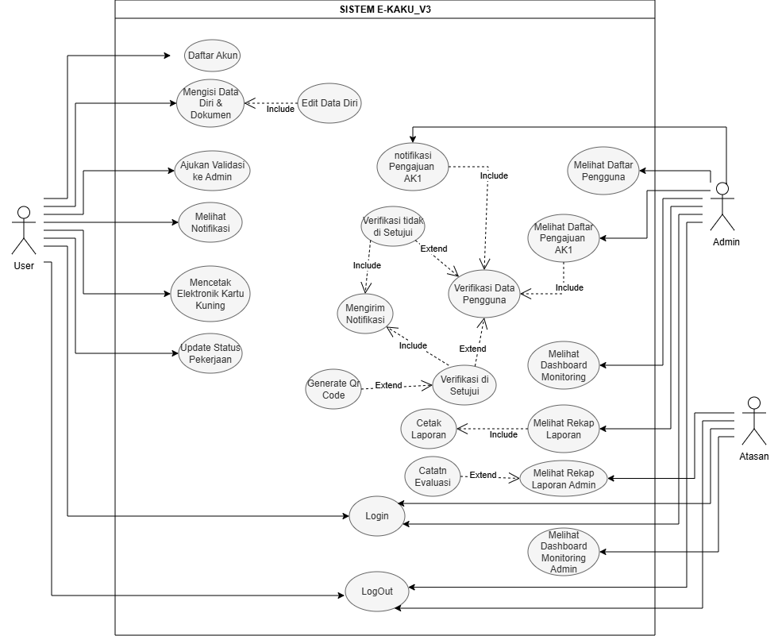

# BAB IV RANCANGAN DAN IMPLEMENTASI SISTEM

## A. Rancangan Usulan

Rancangan usulan merupakan tahap perancangan sistem yang dilakukan berdasarkan hasil analisis kebutuhan pada Sistem E-KAKU V2 di Dinas Tenaga Kerja Kabupaten Pandeglang. Sistem yang berjalan saat ini masih memiliki beberapa keterbatasan, di antaranya proses verifikasi yang belum terintegrasi secara optimal, belum tersedianya fitur pemantauan status pencari kerja secara berkelanjutan, serta belum adanya sarana monitoring yang dapat digunakan oleh pihak manajemen untuk mendukung proses pengambilan keputusan. Oleh karena itu, pada penelitian ini diusulkan pengembangan Sistem E-KAKU V3 berbasis web yang dilengkapi dengan fitur pembaruan status pekerjaan, verifikasi menggunakan QR Code, dashboard monitoring, serta sistem notifikasi otomatis.

Pengembangan sistem dilakukan dengan tujuan untuk meningkatkan efektivitas pelayanan penerbitan Kartu Kuning (AK-1), mempermudah proses verifikasi data pencari kerja, serta menyediakan informasi yang lebih akurat dan terintegrasi bagi Dinas Tenaga Kerja Kabupaten Pandeglang. Sistem yang diusulkan diharapkan mampu mendukung proses pelayanan secara digital sehingga dapat memberikan kemudahan bagi pencari kerja maupun petugas pengelola layanan.

## A.1 Pemodelan Sistem

Pemodelan sistem dilakukan untuk menggambarkan kebutuhan fungsional dan interaksi antar pengguna dengan sistem yang akan dikembangkan. Pada penelitian ini digunakan Unified Modeling Language (UML) sebagai alat bantu pemodelan karena mampu memberikan gambaran yang jelas mengenai proses bisnis, aktor yang terlibat, serta fungsi-fungsi yang tersedia pada sistem. UML digunakan sebagai dasar dalam perancangan sistem sehingga proses implementasi dapat dilakukan secara terstruktur sesuai dengan kebutuhan pengguna.

### 1) Use Case Diagram

Use Case Diagram digunakan untuk menggambarkan hubungan antara aktor dengan fungsi-fungsi yang tersedia pada Sistem E-KAKU V3. Diagram ini menunjukkan aktivitas yang dapat dilakukan oleh setiap aktor sesuai dengan hak akses dan tanggung jawab yang dimiliki. Berdasarkan hasil analisis kebutuhan sistem, terdapat tiga aktor utama yang terlibat, yaitu Pencari Kerja, Admin, dan Atasan.

Pencari Kerja merupakan pengguna utama sistem yang memanfaatkan layanan untuk melakukan pendaftaran akun, melengkapi data diri dan dokumen persyaratan, mengajukan validasi data kepada admin, melihat status verifikasi, mencetak Kartu Kuning elektronik yang telah terverifikasi, serta melakukan pembaruan status pekerjaan. Seluruh proses tersebut dilakukan melalui aplikasi berbasis web sehingga dapat mempermudah akses layanan secara mandiri.

Admin merupakan petugas Dinas Tenaga Kerja yang bertugas mengelola operasional sistem. Admin memiliki kewenangan untuk melihat daftar pengguna, melakukan verifikasi data pencari kerja, mengelola dashboard monitoring, melihat rekap laporan, serta mencetak laporan yang diperlukan dalam proses administrasi pelayanan.

Atasan merupakan pihak manajemen yang memiliki fungsi pengawasan terhadap pelaksanaan layanan. Melalui sistem E-KAKU V3, atasan dapat mengakses dashboard monitoring admin, melihat rekap laporan admin, serta memberikan catatan evaluasi sebagai bahan pengawasan dan peningkatan kualitas pelayanan.

Hubungan antara aktor dan fungsi-fungsi yang tersedia pada sistem E-KAKU V3 dapat dilihat pada Gambar 4.1 Use Case Diagram.

Gambar 4.1. Use Case Diagram

**Tabel 4.1 Keterangan Aktor Use Case Diagram**

Tabel 4.1 menjelaskan aktor yang terlibat dalam Sistem E-KAKU V3 beserta aktivitas yang dapat dilakukan berdasarkan hak akses masing-masing pengguna.

<!-- TABLE_4.1
| No | Aktor | Aktivitas |
| 1 | Pencari Kerja | Melakukan pendaftaran akun, mengisi data diri dan dokumen persyaratan, mengubah data diri, mengajukan validasi kepada admin, melihat status verifikasi, menerima pemberitahuan hasil verifikasi, mencetak Kartu Kuning elektronik, melakukan pembaruan status pekerjaan, login, dan logout. |
| 2 | Admin | Melakukan login, melihat daftar pengguna, memverifikasi data pengguna, memberikan persetujuan atau penolakan verifikasi, melihat dashboard monitoring, melihat rekap laporan, mencetak laporan, serta logout dari sistem. |
| 3 | Atasan | Melakukan login, melihat dashboard monitoring admin, melihat rekap laporan admin, memberikan catatan evaluasi, dan logout dari sistem. |
-->
